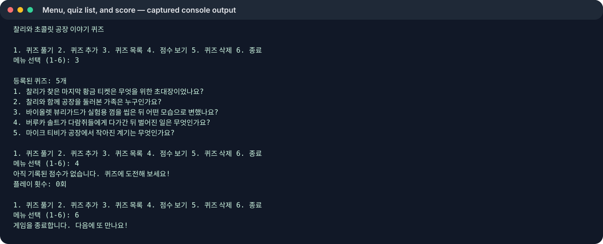
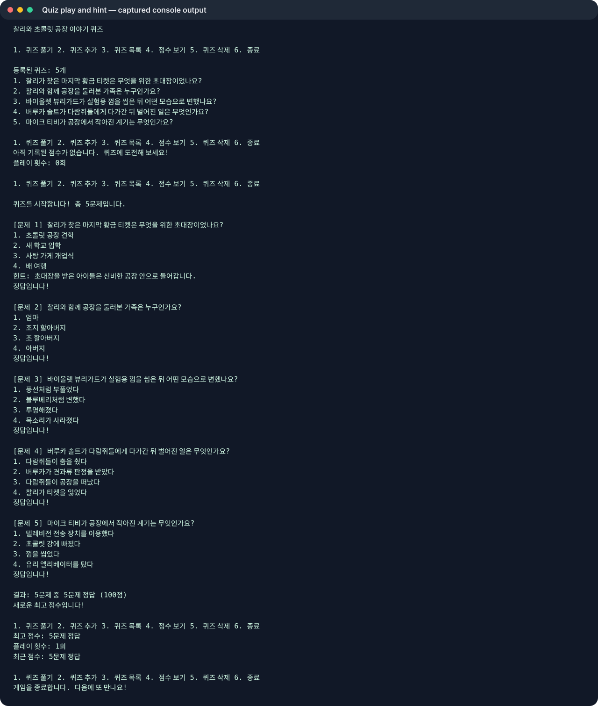
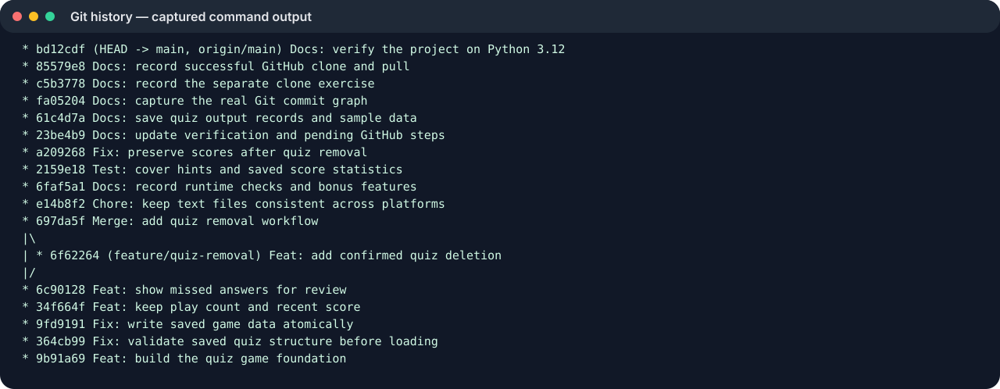

# 찰리와 초콜릿 공장 이야기 퀴즈

터미널에서 로알드 달의 소설 《찰리와 초콜릿 공장》 줄거리를 복습하는 4지선다 퀴즈 게임입니다. 이야기를 기억하는 독자가 즐겁게 풀 수 있도록 찰리와 공장 견학에서 벌어진 일들을 문제로 골랐습니다.

## 실행 환경 및 방법

- 과제 기준: Python 3.10 이상 (표준 라이브러리만 사용)
- 프로젝트 폴더에서 실행: `python3 main.py`
- 자동 점검: `python3 -m unittest -v`
- 현재 작업 환경은 Python 3.9.6이라 이 환경에서 실행과 7개 점검을 확인했습니다. 제출 전에 Python 3.10 이상에서도 같은 명령을 실행해 확인해야 합니다.

## 기능

- 퀴즈 풀기, 새 퀴즈 추가, 문제 목록 보기, 최고 점수 확인
- 답을 입력하기 전에 `h`를 입력해 힌트 보기
- 문제 순서를 무작위로 섞는 보너스 기능
- 오답 복습, 퀴즈 삭제 및 확인 대화상자
- 최고 점수와 함께 플레이 횟수 및 최근 점수 저장
- 입력 오류, 빈 입력, Ctrl+C/EOF 및 JSON 읽기/쓰기 오류 처리
- 문제와 최고 점수를 `state.json`에 저장해 다음 실행에도 유지

## 클래스

- `Quiz`: 질문, 네 개 선택지, 정답 번호와 힌트를 표현하고 JSON 데이터로 변환합니다.
- `QuizGame`: 메뉴, 퀴즈 진행, 점수 및 파일 저장/불러오기를 관리합니다.

## 파일 구조

```text
mission2-quiz/
├── main.py
├── state.json
├── README.md
├── .gitignore
└── docs/
    └── screenshots/
```

`state.json`은 프로젝트 루트에 있으며 UTF-8 JSON입니다. `quizzes` 배열에는 질문과 선택지, 정답 번호, 힌트가 들어가고 `best_score`에는 한 게임에서 맞힌 최고 문항 수, `games_played`에는 전체 플레이 횟수, `last_score`에는 최근 정답 수가 저장됩니다. 퀴즈를 삭제해도 과거 최고 점수 기록은 유지됩니다. 처음 실행할 때 파일이 없으면 기본 문제 5개를 사용합니다.

## 실행 화면

아래 이미지는 실제 프로그램 출력과 Git 로그를 SVG로 렌더링한 기록입니다. 이 실행 환경은 데스크톱 화면 캡처를 제공하지 않아 OS 스크린샷은 포함하지 않았습니다.

- 메뉴, 문제 목록 및 점수: `docs/screenshots/menu-score.svg`
- 퀴즈 플레이와 힌트: `docs/screenshots/play.svg`
- Git 이력: `docs/screenshots/git-log.svg`







## Git 학습 기록

기능 브랜치 `feature/quiz-removal`에서 퀴즈 삭제를 구현하고 `main`에 병합했습니다. 로컬 이력은 기능별 커밋 14개와 병합 기록을 포함합니다. GitHub 저장소가 만들어지면 push와 별도 폴더 clone/push/pull을 수행하고 원격 이력을 확인합니다. 현재 커밋 작성자는 변경을 수행한 Codex Assistant로 표시됩니다.

## 확인 범위

현재 8개 자동 점검이 통과했습니다 (`python3 -m unittest -v`). 테스트는 기본 문제 구성, 입력 검증, 손상된 JSON 복구, 저장 후 재실행, 힌트, 오답 복습, 퀴즈 삭제를 다룹니다. 사용 가능한 Python은 3.9.6이므로 미션 기준 3.10+에서 재검증해야 합니다. GitHub URL, 원격 push 및 화면 캡처는 아직 확인되지 않았습니다.

## Clone 실습 기록

이 문장은 GitHub 저장소를 별도 디렉터리에 `git clone`한 뒤 복제본에서 추가했습니다.
