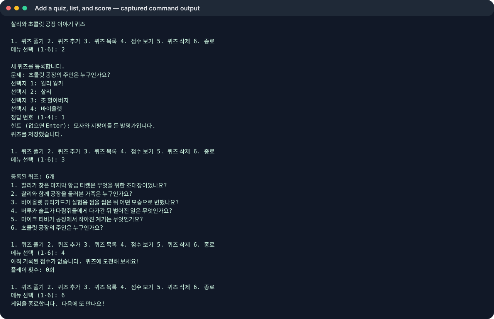
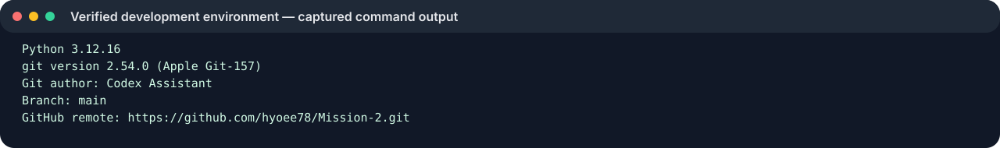

# 찰리와 초콜릿 공장 이야기 퀴즈

터미널에서 로알드 달의 소설 《찰리와 초콜릿 공장》 줄거리를 복습하는 4지선다 퀴즈 게임입니다. 이야기를 기억하는 독자가 즐겁게 풀 수 있도록 찰리와 공장 견학에서 벌어진 일들을 문제로 골랐습니다.

## 실행 환경 및 방법

- 과제 기준: Python 3.10 이상 (표준 라이브러리만 사용)
- 프로젝트 폴더에서 실행: `python3.12 main.py` (Python 3.10 이상이면 해당 버전 명령 사용)
- 자동 점검: `python3.12 -m unittest -v`
- 현재 Mac 기본 `python3`는 3.9.6입니다. Python 3.12.16을 작업 폴더에 격리 설치해 이 미션을 Python 3.10 이상 조건으로 실행하고 확인했습니다.

## 기능

- 퀴즈 풀기, 새 퀴즈 추가, 문제 목록 보기, 최고 점수 확인
- 답을 입력하기 전에 `h`를 입력해 힌트 보기
- 문제 순서를 무작위로 섞는 보너스 기능
- 오답 복습, 퀴즈 삭제 및 확인 대화상자
- 최고 점수와 함께 플레이 횟수 및 최근 점수 저장
- 입력 오류, 빈 입력, Ctrl+C/EOF 및 JSON 읽기/쓰기 오류 처리
- 문제와 최고 점수를 `state.json`에 저장해 다음 실행에도 유지

## 클래스

- `Quiz`: 질문 데이터의 유효성(질문/선택지/정답)을 확인하고 `to_dict`/`from_dict`로 JSON에 저장할 자료와 객체 사이를 변환합니다.
- `QuizGame`: `load_state`/`save_state`의 저장, `read_nonempty`/`read_number`의 사용자 입력 검사, `play`/`add_quiz`/`delete_quiz`의 게임 동작, `show_quizzes`/`show_score`의 표시를 맡습니다. `run`은 메뉴에서 이 동작들을 연결합니다.

질문과 점수처럼 서로 연관된 상태를 `Quiz`와 `QuizGame` 객체에 모아 데이터 검증과 게임 흐름을 한 곳에서 다루기 위해 클래스를 사용했습니다. 함수만으로 만들면 간단한 시작은 가볍지만 상태를 여러 함수 인자로 전달하고 변경하는 책임이 흩어지기 쉽습니다. 현재 규모에서는 객체가 상태와 관련 동작을 함께 보여주는 이점이 있습니다. 데이터가 더 커지거나 기능이 많아지면 저장소 클래스를 따로 두거나 데이터베이스 계층을 추가할 수 있습니다.

## 파일 구조

```text
mission2-quiz/
├── main.py
├── state.json
├── README.md
├── .gitignore
└── docs/
    └── screenshots/
```

`state.json`은 프로젝트 루트에 있으며 UTF-8 JSON입니다. 사람이 읽고 편집하기 쉽고 Python 외의 도구에서도 다루기 쉬워 과제 규모의 저장 형식으로 선택했습니다. `quizzes` 배열의 각 객체는 질문, 선택지 배열, 정답 번호, 힌트를 담습니다. 이 구조는 문제별 필드와 문제 목록을 명확히 표현하고, 향후 설명이나 태그 같은 필드를 추가하기 쉽습니다. `best_score`에는 한 게임에서 맞힌 최고 문항 수, `games_played`에는 전체 플레이 횟수, `last_score`에는 최근 정답 수가 저장됩니다. 퀴즈를 삭제해도 과거 최고 점수 기록은 유지됩니다. 처음 실행할 때 파일이 없으면 기본 문제 5개를 사용합니다.

JSON 전체를 메모리에 읽고 다시 쓰므로 데이터가 매우 커지면 시작/저장 시간이 늘고 메모리 사용량도 커집니다. 동시 사용자 간 쓰기 충돌, 부분 검색, 세밀한 트랜잭션도 JSON 파일만으로 처리하기 어렵습니다. 문제 수가 크게 늘면 SQLite 같은 데이터베이스로 옮기는 편이 적합합니다.

### 입력과 저장 책임

- 입력 검증은 `QuizGame.read_nonempty`, `QuizGame.read_number`가 담당하고, `Quiz` 생성자는 저장 데이터와 새 문제의 필드 유효성을 다시 확인합니다.
- JSON 입출력은 `QuizGame.load_state`와 `QuizGame.save_state`가 담당합니다. 메뉴/게임 함수는 검증된 객체를 사용하며 파일 형식을 직접 다루지 않습니다.
- 저장 순서: 객체를 JSON 자료로 변환 → `state.json.tmp`에 UTF-8로 기록 → 파일 쓰기 완료 후 `replace`로 `state.json` 교체.
- 읽기 순서: 파일 존재 확인 → JSON 파싱 → 각 문제를 `Quiz`로 검증 → 상태 적용. 파싱/형식이 손상되면 기본 문제로 시작하고 원본을 `state.json.corrupt`(이미 있으면 `.corrupt.previous`)로 보존합니다.

```text
입력 → read_number/read_nonempty → Quiz 검증 → QuizGame 상태
                                      ↓ 저장
state.json ← 원자적 교체 ← state.json.tmp ← JSON 직렬화
                                      ↑ 읽기
state.json → JSON 파싱 → Quiz 검증 → QuizGame 상태
```

### 오류 및 복구

- 메뉴의 빈 값, 숫자가 아닌 값, 범위 밖 숫자는 안내를 출력하고 다시 입력받습니다. 퀴즈 답변은 `1`~`4` 또는 힌트 `h`만 받습니다.
- JSON 문법 오류나 데이터 형식 오류가 나면 프로그램은 기본 문제로 시작하며 손상 파일을 `.corrupt`로 보존합니다. 프로그램을 종료하기 전에 보존 파일을 다른 위치에 복사하고, 텍스트 편집기로 내용을 확인하세요. 복구할 수 있는 JSON이면 백업 파일을 `state.json`으로 되돌려 실행합니다. 복구할 수 없으면 보존 파일을 그대로 두고 새 `state.json`을 생성하도록 프로그램을 실행할 수 있습니다.
- 읽기 권한/디스크 오류 안내가 나오면 저장 파일의 권한과 디스크 여유 공간을 확인하세요. 저장 쓰기 실패는 오류를 출력하고 임시 파일을 정리하려고 시도합니다. `state.json.tmp`만 남았다면 원본을 덮어쓰지 말고 먼저 별도 복사한 뒤 JSON이 완전한지 확인하세요.
- Ctrl+C 또는 입력 종료(EOF)는 안전 종료 경로에서 현재 상태를 저장합니다. 다음 실행 후 메뉴의 `4. 점수 보기`와 `3. 퀴즈 목록`으로 복원된 상태를 확인할 수 있습니다.

### 기본 문제 편집

기본 문항을 바꾸려면 `main.py`의 `default_quizzes()`에서 `Quiz(질문, 선택지 4개, 정답 번호, 힌트)`를 편집하세요. 새 설치에만 기본값으로 적용됩니다. 이미 만들어진 `state.json`이 있으면 저장된 문제가 우선하므로, 기존 상태를 유지하며 문항을 추가할 때는 메뉴의 `2. 퀴즈 추가`를 사용하세요.

### 변경 영향도

| 요구 변경 | 수정할 파일/함수 |
|---|---|
| 기본 질문/선택지 변경 | `main.py`: `default_quizzes` |
| 문제 필드 또는 검증 규칙 변경 | `main.py`: `Quiz.__init__`, `to_dict`, `from_dict`; `test_quiz.py` |
| 저장 필드/파일 형식 변경 | `main.py`: `QuizGame.load_state`, `save_state`; `README.md`; `test_quiz.py` |
| 메뉴 항목/기능 연결 변경 | `main.py`: `QuizGame.run` 및 해당 기능 메서드 |
| 답 입력 규칙 변경 | `main.py`: `read_number`, `read_nonempty`, `play`; `test_quiz.py` |
| 실행/설치 또는 평가 증빙 변경 | `README.md`, 필요 시 `docs/screenshots/` |

## 실행 화면

아래 이미지는 실제 프로그램 출력과 Git 로그를 SVG로 렌더링한 기록입니다. 이 실행 환경은 데스크톱 화면 캡처를 제공하지 않아 OS 스크린샷은 포함하지 않았습니다.

- 메뉴, 문제 목록 및 점수: `docs/screenshots/menu-score.svg`
- 문제 추가와 추가 후 목록: `docs/screenshots/add-quiz.svg`
- 퀴즈 플레이와 힌트: `docs/screenshots/play.svg`
- 개발환경 버전/원격 설정: `docs/screenshots/environment.svg`
- Git 이력: `docs/screenshots/git-log.svg`







## Git 학습 기록

기능 브랜치 `feature/quiz-removal`에서 퀴즈 삭제를 구현하고 `main`에 병합했습니다. 기능을 격리해 작업하고 확인 후 합치기 위해 브랜치를 사용했습니다. 이 연습 저장소에서는 기능 완료 후 `main`으로 병합하며, 기능 브랜치 작업은 병합 커밋으로 남깁니다. [GitHub 공개 저장소](https://github.com/hyoee78/Mission-2)의 `main`에 push했습니다. 별도 폴더 `work/mission2-clone`에서 README를 수정해 커밋 `c5b3778`로 push했고, 원래 폴더에서 `git pull --ff-only origin main`으로 fast-forward 반영을 확인했습니다. `git init`, `add`, `commit`, `push`, `pull`, `checkout`, `clone` 명령을 실제 사용했습니다.

커밋은 한 목적의 변경만 담고, 제목은 `type: 간결한 동사형 요약` 형식을 사용합니다(예: `feat: 퀴즈 삭제 메뉴 추가`, `docs: 실행 방법 설명`). 본문은 이유나 중요한 구현 선택이 제목만으로 분명하지 않을 때 덧붙입니다. 기능 브랜치는 `feature/<기능>`으로 이름 붙입니다. 이 평가 보완 커밋을 포함해 `main`에는 19개 커밋이 있습니다. 커밋 작성자는 변경을 수행한 Codex Assistant로 표시됩니다.

## 확인 범위

Python 3.12.16에서 8개 자동 점검이 통과했습니다 (`python3.12 -m unittest -v`). 테스트는 기본 문제 구성, 입력 검증, 손상된 JSON 복구, 저장 후 재실행, 힌트, 오답 복습, 퀴즈 삭제를 다룹니다. 프로그램 출력과 Git 로그는 SVG 및 텍스트로 저장했습니다. 이 환경에서는 OS 화면 캡처를 만들 수 없어 데스크톱 스크린샷은 포함하지 않았습니다.

## Clone 실습 기록

이 문장은 GitHub 저장소를 별도 디렉터리에 `git clone`한 뒤 복제본에서 추가했습니다.
